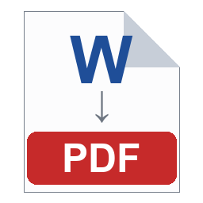

# DOCX to PDF

A small Windows app that turns a Word document (.docx or .doc) into a PDF. It has Word do the export, so the PDF looks exactly like the document does in Word.

It converts one file at a time. That's on purpose: it's for turning a sermon, lesson or article into a PDF when you need it.

## Requirements

- Windows 10 or later
- Microsoft Word (Home, Pro or Microsoft 365)

## Download

[Download DocxToPdf.exe](https://github.com/jmitchell238/docx-to-pdf/releases/latest/download/DocxToPdf.exe) from the latest release and run it. There's nothing to install, and you don't need Python. All versions are on the [releases page](https://github.com/jmitchell238/docx-to-pdf/releases).

The first time you run it, Windows may say "Windows protected your PC", because the app isn't code-signed. Click More info, then Run anyway.

To get a desktop shortcut, right-click `DocxToPdf.exe` and choose Send to → Desktop (create shortcut).

It takes a second or two to open, because the app unpacks itself to a temporary folder first.

## Using it

1. Next to "Word file", click Browse and pick the document.
2. Next to "Save to", pick the folder for the PDF.
3. Click Convert.

The PDF gets the same name as the document (`Sermon.docx` becomes `Sermon.pdf`) and replaces any PDF with that name already in the folder. The Word document is opened read-only and never changed.

## If something goes wrong

- "Microsoft Word is required but wasn't found": Word isn't installed, or Windows can't reach it. Install Word, or restart the computer if it's already installed.
- "Could not write the PDF. Close it if it's open in another program and try again.": the PDF is open somewhere, usually a PDF reader or browser. Close it and convert again.
- "Source file not found": the document has moved or been renamed. Pick it again with Browse.
- It freezes, or says "Unexpected error": close the app and try again. If it keeps happening, Word may need repairing.

## Development

See [docs/DEVELOPMENT.md](docs/DEVELOPMENT.md) for running and building it from source and using it as a Python library. [docs/ARCHITECTURE.md](docs/ARCHITECTURE.md) and [docs/DECISIONS.md](docs/DECISIONS.md) explain how it works and why.

## License

MIT. See [LICENSE](LICENSE).
